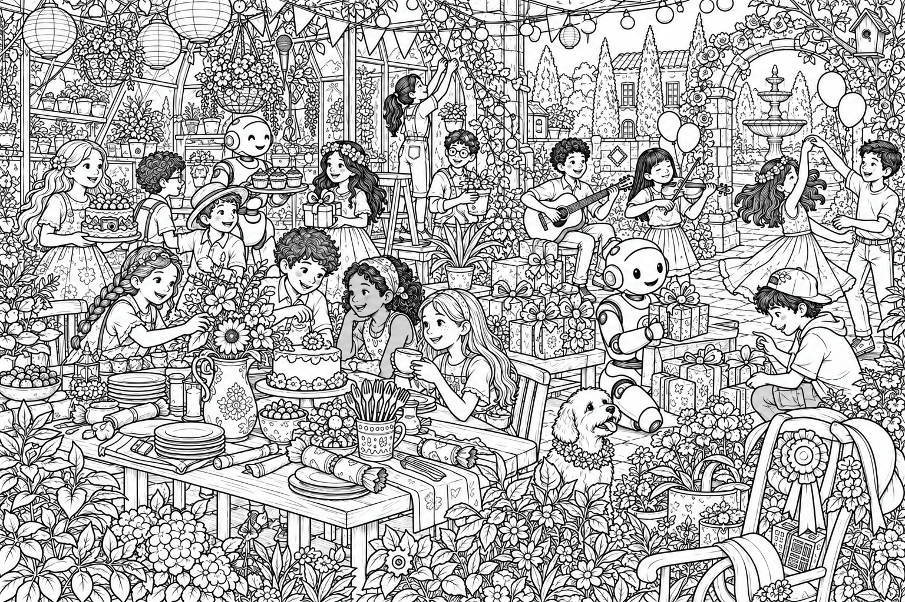
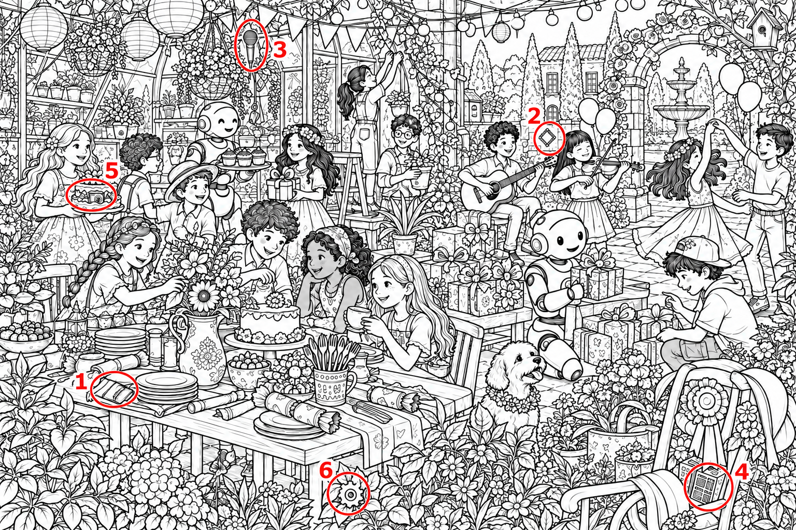

# 儿童科普找物品游戏 Skill

## 用途

在完整场景中隐藏指定物品，制作供儿童观察和寻找的视觉游戏。适用于儿童绘本、科普书和活动书，也支持明确指定的双图找不同任务。

Skill 的调用名称为 `children-picture-puzzles`。本仓库保留原始 Skill、提示词、案例说明以及 2 张参考图片。

## 安装

已安装 Node.js 和 npm 的用户，可运行：

```bash
npx skills add xchenyang3/hidden-object-game-skill -g
```

也可以下载仓库，将 `skills/children-picture-puzzles` 整个文件夹放入支持 Skill 的工具所使用的技能目录，保留全部子目录。

运行环境需要提供图像生成与编辑能力。安装 Skill 不会安装图像模型或授予工具权限。压缩包名称中的“适用于 ChatGPT”是原始文件命名，不代表所有客户端都支持直接安装。

## 使用示例

```text
请用 children-picture-puzzles 制作一张儿童科普找物品游戏。
场景是温室庭院派对，黑白精细线稿，中等难度。
隐藏电池、芯片、麦克风、电路板、相机和齿轮，各 1 个。
物品融入场景线条，保留能辨认的关键结构。
先给无标记的学生图，再单独给答案图和目标核对清单。
```

调用时可指定年龄、场景、目标物品、画风、难度、画幅和交付范围。没有现成形象参考时，需另行提供要沿用的角色形象。

## 制作流程

1. 明确游戏类型，建立目标及数量清单。
2. 设计可信场景，将目标融入轮廓、花纹或局部遮挡。
3. 生成后逐件查找，检查缺失、重复及容易误认的对象。
4. 根据最终图中的实际位置制作答案。
5. 核对答案是否匹配，并记录当前验证状态。

难度通过旋转、相似轮廓和环境融合调节。目标仍需保留可辨认结构，不依赖微小尺寸或杂乱线条。

## 效果参考

以下图片来自所提供的 Skill 压缩包，是派对案例的视觉参考。它们不是经过全数唯一性核验或印前检查的认证样本。



<details>
<summary>查看对应答案试样</summary>



</details>

## 文件结构

```text
skills/children-picture-puzzles/
├── SKILL.md
├── agents/openai.yaml
├── references/
│   ├── prompts.md
│   └── party-case.md
└── assets/
    ├── party-hidden-objects-v2.png
    └── party-answer-v2.png
```

## 使用限制

生成工具可能漏画目标、重复绘制物品，或在标注答案时改变原图。需以实际画面为准核查，不能直接沿用提示词中的预设位置。

屏幕检查不能代替儿童试玩和印刷检查。用于科普内容时，还需核对目标物件的形态和相关知识说明。
